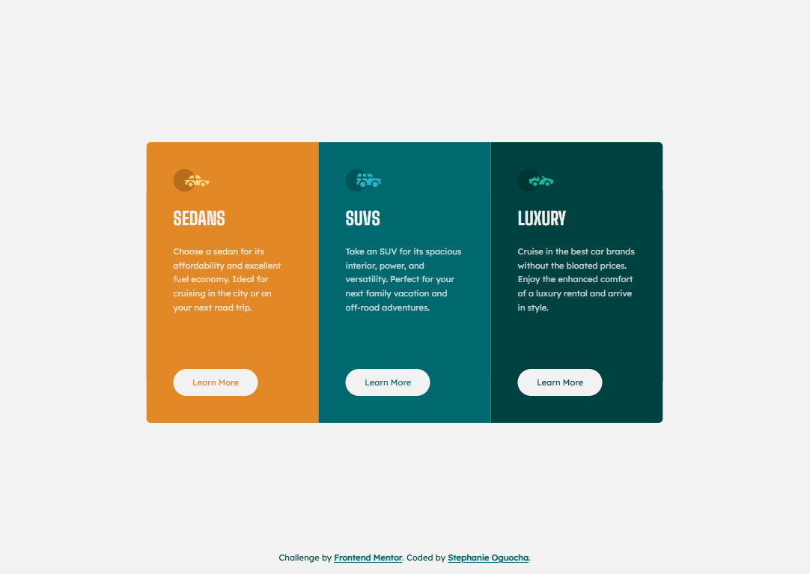
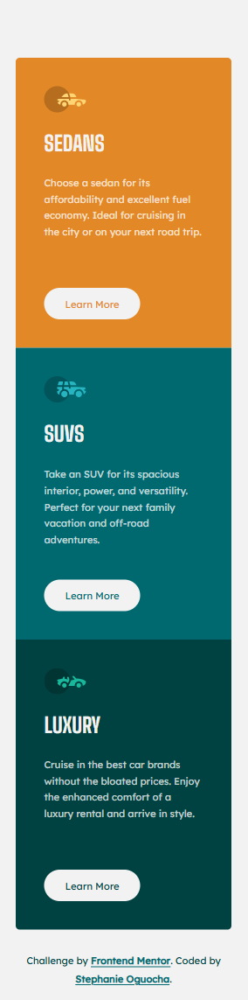

# Frontend Mentor - 3-column Preview Card Component

This is my solution to the [3-column preview card component challenge on Frontend Mentor](https://www.frontendmentor.io/challenges/3column-preview-card-component-pH92eAR2-). This project helped me practice building responsive layouts with HTML and CSS while matching a provided design.

## Table of Contents

- [Overview](#overview)
  - [The Challenge](#the-challenge)
  - [Screenshot](#screenshot)
  - [Links](#links)
- [My Process](#my-process)
  - [Built With](#built-with)
  - [What I Learned](#what-i-learned)
  - [Continued Development](#continued-development)
  - [Useful Resources](#useful-resources)
  - [AI Collaboration](#ai-collaboration)
- [Author](#author)

## Overview

### The Challenge

The goal was to build a three-column preview card component that closely matches the provided design.

Users should be able to:

- View the layout adapted to their device's screen size.
- See hover states for interactive elements.
- Read the card content comfortably on desktop and mobile screens.

### Screenshot

#### Desktop View



#### Mobile View




### Links

- **Github Repo URL:** [Github Repo URL here](https://github.com/stephany247/3-column-preview-card-component-main).
- **Live Site URL:** [Live Demo here](https://stephany247.github.io/3-column-preview-card-component-main/).

## My Process

### Built With

- Semantic HTML5
- CSS custom properties (variables)
- Flexbox
- Responsive design using media queries
- REM units for spacing and sizing
- Google Fonts
- CSS transitions and pseudo-classes
- Keyboard accessibility with `:focus-visible`
- Mobile and desktop design references

### What I Learned

This project helped me improve my understanding of responsive layouts, Flexbox, CSS spacing, and interactive states.

**1. Building responsive layouts with Flexbox**

I used Flexbox to arrange the cards horizontally on larger screens and stack them vertically on smaller screens.

```css
.container {
  display: flex;
  width: 100%;
}

@media (max-width: 62rem) {
  .container {
    flex-direction: column;
  }
}
```

**2. Using CSS custom properties**

I defined the project's color palette using CSS variables, making the styles easier to maintain and update.

```css
:root {
  --gold: hsl(31, 77%, 52%);
  --cyan: hsl(184, 100%, 22%);
  --green: hsl(179, 100%, 13%);
  --paragraph: hsla(0, 0%, 100%, 0.75);
  --light-gray: hsl(0, 0%, 95%);
}
```

**3. Working with REM units**

I converted fixed pixel measurements to REM units to make spacing and sizing more consistent and responsive to the root font size.

**4. Creating interactive button states**

I used CSS transitions to create a smooth hover effect and added a visible focus state for keyboard users.

```css
.btn {
  transition:
    background-color 0.25s ease,
    color 0.25s ease;
}

.btn:hover {
  color: var(--light-gray);
  background-color: transparent;
}

.btn:focus-visible {
  outline: 0.125rem solid var(--light-gray);
  outline-offset: 0.25rem;
}
```

**5. Positioning the attribution**

I learned how positioning and document flow affect the footer's placement across different screen sizes. The goal was to keep the attribution at the bottom of the viewport when space permits, while allowing it to follow the cards naturally on smaller screens.

### Continued Development

In future projects, I want to continue improving my skills in:

- Building accessible and responsive interfaces.
- Writing cleaner, more maintainable CSS.
- Choosing appropriate breakpoints based on content.
- Improving visual accuracy when translating design references into code.
- Testing layouts across different screen sizes and browsers.

### Useful Resources

- [Frontend Mentor](https://www.frontendmentor.io/) - Provided the design challenge and reference images.
- [MDN Web Docs: CSS Flexbox](https://developer.mozilla.org/en-US/docs/Web/CSS/CSS_flexible_box_layout) - Helped me understand flexible layouts.
- [MDN Web Docs: CSS Media Queries](https://developer.mozilla.org/en-US/docs/Web/CSS/CSS_media_queries/Using_media_queries) - Useful for implementing responsive behavior.
- [Google Fonts](https://fonts.google.com/) - Used to load Lexend Deca and Big Shoulders.

### AI Collaboration

I used ChatGPT as a development assistant during this project.

- **Implementation support:** Helped structure and refine the HTML and CSS.
- **Responsive design:** Assisted with adjusting the card layout and spacing across screen sizes.
- **Code refinement:** Helped convert pixel values to REM units and organize the attribution styles.
- **Learning:** Helped explain CSS positioning, Flexbox behavior, hover effects, and keyboard focus states.

I reviewed and adapted the suggestions to fit the project and used the process to improve my understanding of CSS.

## Author

- Frontend Mentor - [@stephany247](https://www.frontendmentor.io/profile/stephany247)

